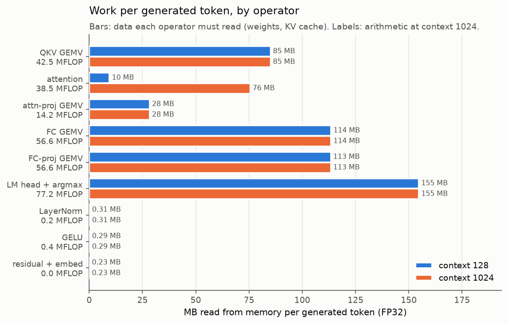
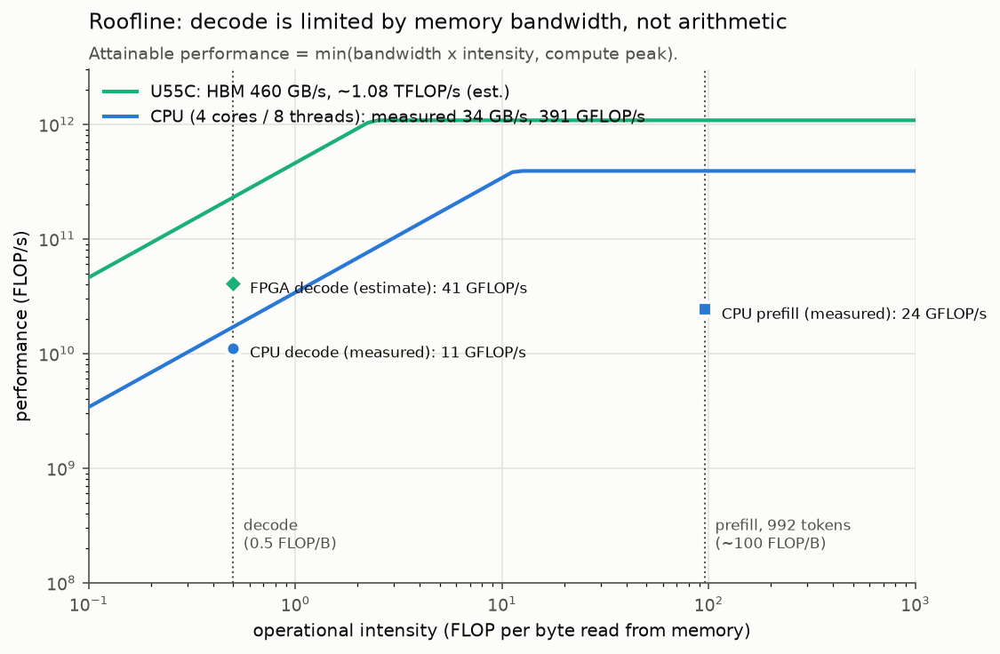
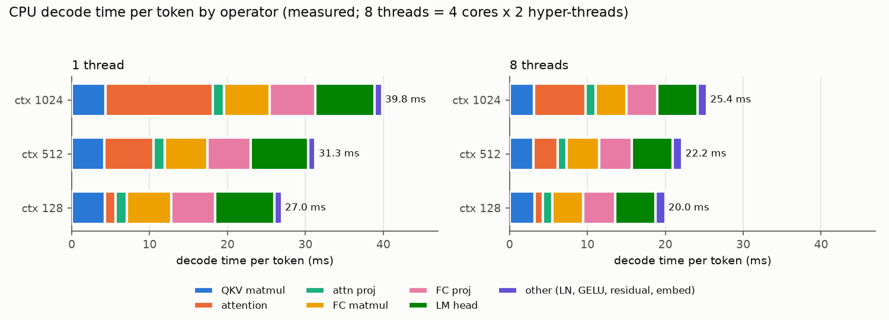
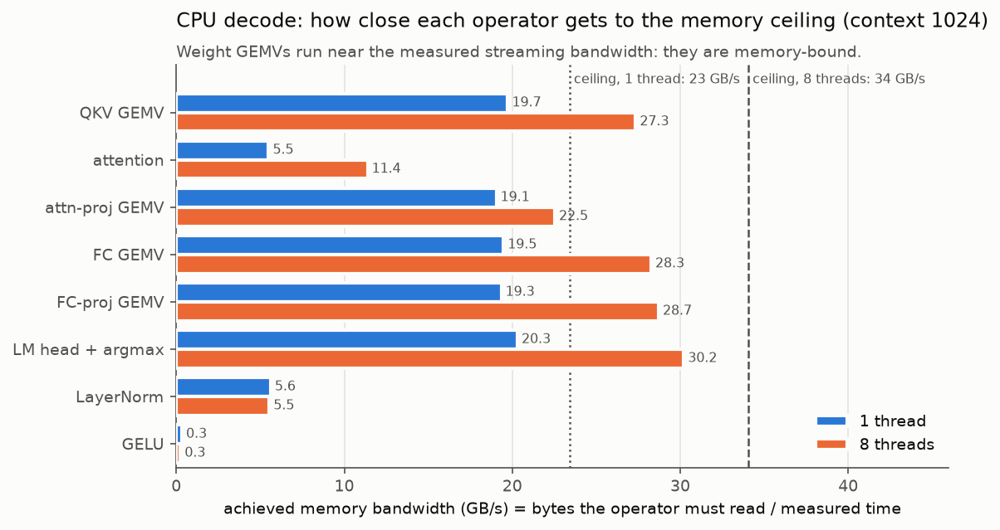
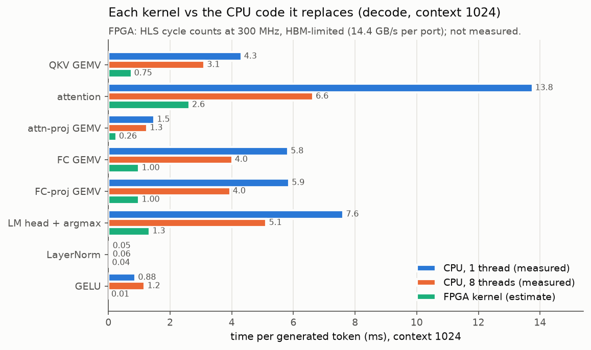
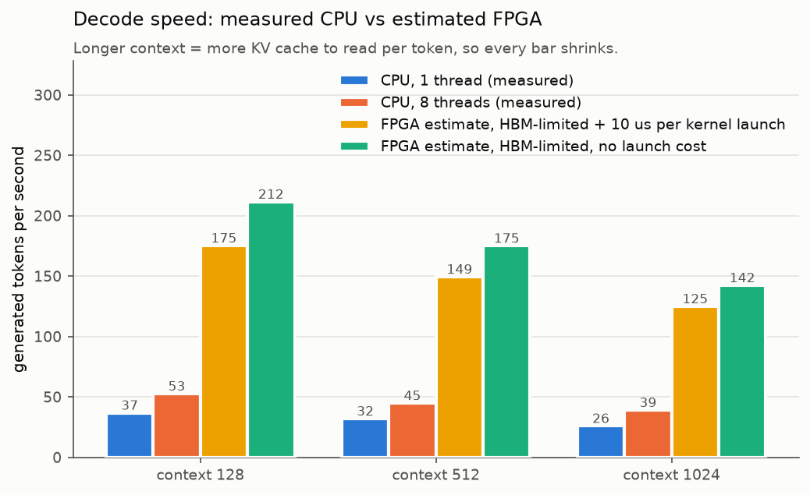

# GPT-2 (124M) inference on the Alveo U55C: progress report

**Scope.**
- Inference only, with the pretrained OpenAI GPT-2 small weights (124M
  parameters).
- FP32, batch 1, greedy decoding, KV cache.
- Tokenization runs on the host CPU.

**Status.**
- All six FPGA kernels are written, tested and synthesized.
- The whole model running on the kernels (in simulation) reproduces Hugging Face's
  output token for token.
- No FPGA board is available yet, so every FPGA speed number below is an
  **estimate** from synthesis reports. All CPU numbers are measured.

**The story of this report in five points**
1. Generating a token means reading all ~500 MB of weights from memory while doing
   only 0.5 arithmetic operations per byte read. GPT-2 decoding is therefore
   limited by **memory bandwidth**, not arithmetic (§1).
2. The CPU baseline confirms it. Its weight-multiplication code runs at about 83%
   of the memory bandwidth we measured on this machine, while using under 10% of
   its arithmetic capability (§2).
3. The U55C has 460 GB/s of HBM bandwidth, about 13× what the CPU gets. The kernels
   are designed around that: they stream weights from many memory channels in
   parallel and do the math as the data flows by (§3).
4. Correctness is established in four levels, from single kernels up to the whole
   model. All 12 tests pass, and the generated tokens are identical to Hugging
   Face (§4).
5. From the synthesis reports, the current design is estimated at **3.2–4× the
   4-core CPU** (about 125–212 vs 39–53 tokens/s). The limit is clear: the kernels
   use only 8 of the 32 HBM channels and run one at a time. Fixing that is the
   main next step (§5, §6).

Every number comes from a script in this repository; the source is named next to
each chart or table. Plain-language background: [`WALKTHROUGH.md`](WALKTHROUGH.md).

---

## 1. Application analysis

### 1.1 What GPT-2 computes for one token

GPT-2 is a *decoder-only* transformer. "Decoder-only" describes the architecture:
there is no separate encoder, and each token may only look at earlier tokens
(causal attention).

One token goes through 12 identical layers ("blocks"):

```
x = embedding(token) + position_embedding(pos)            768 numbers
for each of 12 layers:
    h = LayerNorm(x)
    q, k, v = W_qkv · h                                   matrix (2304 × 768) × vector
    store k, v in the KV cache
    a = attention(q, all cached k, v)                      12 heads × 64 dims
    x = x + W_proj · a                                     (768 × 768) × vector
    h = LayerNorm(x)
    x = x + W_fcproj · GELU(W_fc · h)                      (3072 × 768), then (768 × 3072)
logits = wte · LayerNorm(x)                               (50257 × 768) × vector
next token = argmax(logits)
```

### 1.2 Prefill and decode: two different workloads

Generating text has two phases. Both run the same network:

| | prefill | decode |
|---|---|---|
| what it does | reads the whole prompt and produces the first new token | produces each following token, one at a time |
| tokens per pass | all T prompt tokens together | 1 |
| matrix math | matrix × matrix (T columns) | matrix × vector |
| weight reuse | each weight is used T times per read | each weight is used once per read |
| KV cache | filled for all prompt tokens | one row appended, all rows read |
| limited by | arithmetic (for long prompts) | memory bandwidth |

**Decode is the focus of this project.** It runs once per generated token, so it
dominates the time of any long generation. It is also where an FPGA's memory
system helps most.

In the current FPGA flow, the prompt is fed through the decode kernels one token
at a time. This is correct but slower than a real prefill (§6).

### 1.3 How much work one decoded token needs

**How it is counted** (`analysis/analyze.py`, from the model dimensions only):
- A matrix-vector product with a weight matrix of size OC × C does 2·C·OC FLOPs: one
  multiply and one add per weight. It must read 4·C·OC bytes of FP32 weights.
- Attention at context length *n* reads the whole cache, 2·n·768·4 bytes per layer,
  and does about 4·n·768 FLOPs per layer.



*`results/figures/work_per_op.png`*

What the chart shows:
- **Almost all the data is weights.** The five weight multiplications (QKV,
  attention projection, FC, FC-projection, LM head) read 495 MB per token.
  LayerNorm, GELU and the residual adds together read under 1 MB. They are
  negligible.
- **The KV cache is the part that grows.** It is 10 MB at context 128 but 76 MB at
  context 1024, so attention matters more for long texts.
- **The LM head alone is 27% of the data.** It multiplies by the 50,257 × 768
  vocabulary matrix.

### 1.4 What limits decode speed: the roofline

The key ratio is **operational intensity** = FLOPs ÷ bytes read.
- For every weight multiplication in decode it is exactly 2 FLOPs per 4-byte
  weight, i.e. **0.5 FLOP/byte**.
- A chip is limited by memory, not arithmetic, whenever this is lower than its
  (compute peak ÷ memory bandwidth). That ratio is about 11 for the CPU and about
  2.3 for the U55C. Decode, at 0.5, is far below both, so on either chip it is
  **memory-bound**.
- Prefill reuses each weight T times, so its intensity is about 100 FLOP/byte for
  a 992-token prompt. That makes it compute-bound.



*`results/figures/roofline.png`. The CPU lines use ceilings measured on this
machine (§2.1). The U55C compute ceiling is an estimate: 9024 DSPs ÷ 5 DSPs per
FP32 multiply-add × 2 FLOPs × 300 MHz.*

The roofline turns directly into a **speed limit** for decode:
**tokens/s ≤ memory bandwidth ÷ bytes per token.**

| at context 1024 (572 MB/token) | bandwidth | upper bound |
|---|---|---|
| CPU, 8 threads (measured bandwidth) | 34 GB/s | 60 tokens/s |
| U55C, all 32 HBM channels | 460 GB/s | 804 tokens/s |

This 13× gap in bandwidth is the opportunity for the FPGA.

**On-chip memory cannot hold the model.** The U55C has 44.7 MB of on-chip memory
(BRAM + URAM). The weights are 498 MB and the KV cache up to 76 MB. So weights and
cache must be streamed from HBM for every token, and the design has to be built
around streaming, not caching. (Details: `results/analysis/analysis.md`, on-chip
fit table.)

---

## 2. CPU baseline

### 2.1 Setup

**What runs.** `src/cpu` contains the llm.c forward functions, adapted for
inference:
- A KV cache is added.
- There is a single-token path for decode.
- The LM head is fused with argmax.

It is checked against Hugging Face before any timing (§4, level L1).

**Machine.**
- CPU: AMD EPYC 7713. The container is given **4 physical cores with 2
  hyper-threads each (8 hardware threads)**, with AVX2/FMA.
- Compiler: g++ 13.3 with `-O3 -march=native -fopenmp`.
- The weights (500 MB) are far larger than the CPU's caches (32 MB L3 per
  core-complex), so every token streams them from DRAM.

**The machine's own ceilings** (`make -C src/cpu peaks`, `results/cpu_peaks.csv`).
To judge whether the CPU code is good, we need to know what the hardware can do:

| | 1 thread | 8 threads |
|---|---|---|
| memory read bandwidth (streaming a 1 GiB array) | 23.4 GB/s | 34.1 GB/s |
| FP32 arithmetic peak (AVX2 FMA on registers) | 98 GFLOP/s | 391 GFLOP/s |

8 threads give 4× the arithmetic, which is the 4 physical cores. They give only
1.46× the memory bandwidth, because the cores share the memory system.

**How decode speed is measured** (`build/bin/cpu_main profile`):
- For context length *n*, the model first runs a prompt of *n* − 32 tokens taken
  from `data/long_prompt_ids.i32`, then generates 31 tokens.
- Decode speed is the mean time of those 31 steps; each configuration is run 3
  times and the median is reported.
- A second pass with a timer around every operator gives the per-operator
  breakdown.

### 2.2 Results

| threads | context 128 | context 512 | context 1024 |
|---|---|---|---|
| 1 | 36.8 tokens/s | 32.0 tokens/s | 25.9 tokens/s |
| 8 | 52.7 tokens/s | 44.8 tokens/s | 39.1 tokens/s |

*`results/cpu_profile_summary.csv`*



*`results/analysis/cpu_breakdown.png`: decode time per token, split by operator.*

Where the time goes:
- At short context, the weight multiplications take **over 90%** of the time. The
  LM head is the single largest piece, at 28%.
- As the context grows, **attention** grows from 5% to 35% (1 thread).
- LayerNorm, GELU and residual are small.

### 2.3 What the bottleneck is, and the evidence

If the weight multiplications are memory-bound, their speed should approach the
measured memory ceiling. To test this, divide each operator's bytes (from §1.3) by
its measured time:



*`results/figures/cpu_bandwidth_per_op.png`*

- **Weight multiplications are memory-bound.** QKV, FC, FC-projection and the LM
  head all reach 19–20 GB/s on 1 thread and 27–30 GB/s on 8 threads. That is
  **80–89% of the measured ceiling**. Their arithmetic is under 10% of the CPU's
  peak. Faster arithmetic would not help; only more bandwidth would.
- **Adding threads helps exactly as much as bandwidth grows.** 8 threads make decode
  1.43× faster at context 128, and the measured bandwidth grows by 1.46×. Prefill,
  which is compute-bound, speeds up by 2.7–3.5× with the same threads. This is
  further confirmation that decode is limited by memory.
- **Attention is *not* memory-bound on the CPU.** It reaches only 5.5 GB/s. The
  llm.c attention does three passes (scores, softmax, weighted sum), reads each
  head's slice of the cache with a stride, and evaluates an `exp` per score. So it
  is limited by its implementation, and it grows with context. A single-pass
  streaming design should do much better.
- **GELU is limited by arithmetic.** Evaluating `tanh` 36,864 times per token takes
  0.9 ms. It is a small piece of the total, but easy to remove in hardware.

Summary of the CPU: it decodes at 60–80% of its own bandwidth limit. The
weight multiplications are close to their ceiling; the rest of the gap is
attention.

### 2.4 Why an FPGA can do better

1. **More bandwidth.** The U55C's HBM gives 460 GB/s, versus 34 GB/s measured on
   the CPU. For a memory-bound workload, this is the main lever.
2. **Bandwidth that the design can actually use.** A GEMV kernel can read many HBM
   channels at once. Every 512-bit word goes straight into 16 multiply-adds, with
   no cache misses and no instruction overhead.
3. **Better algorithms for the non-GEMV parts.** Attention can be done in **one
   streaming pass** over the cache (online softmax), with all 12 heads in parallel.
   GELU and LayerNorm become a few cycles of pipelined arithmetic.
4. **Less data movement.** The LM head is fused with argmax, so the 50,257 logits
   never leave the chip; only the winning token ID does.

---

## 3. Kernel design

### 3.1 Operator → kernel mapping

A **model operator** is one step of the math in §1.1, for example "QKV
projection" or "GELU". A **kernel** is a piece of hardware on the FPGA. The mapping
says which kernel executes which operator, so the host program knows what to call
for each step.

The four weight multiplications share one GEMV kernel, because they are the same
math with different sizes. The residual add is folded into the GEMV's output stage
(`y = W x + b + residual`), so it costs no separate pass.

| model operator | math | input → output (per token) | kernel | calls per token |
|---|---|---|---|---|
| embedding | `x = wte[token] + wpe[pos]` | token ID → 768 | host CPU (a table lookup) | 1 |
| LayerNorm 1, 2, final | normalize, then scale and shift | 768 → 768 | `LayerNormKernel` | 25 |
| QKV projection | `qkv = W_qkv h + b` | 768 → 2304 | `GemvKernel` | 12 |
| attention + KV cache | append k, v; softmax(q·Kᵀ/8)·V per head | 2304 + cache → 768 | `AttentionKernel` | 12 |
| attention projection + residual | `x = x + W_proj a + b` | 768 → 768 | `GemvKernel` (residual fused) | 12 |
| MLP up (FC) | `u = W_fc h + b` | 768 → 3072 | `GemvKernel` | 12 |
| GELU | elementwise | 3072 → 3072 | `GeluKernel` | 12 |
| MLP down (FC-proj) + residual | `x = x + W_fcproj g + b` | 3072 → 768 | `GemvKernel` (residual fused) | 12 |
| LM head + argmax | `argmax(wte · h)` | 768 → 1 token ID | `LmHeadKernel` | 1 |

That makes **98 kernel calls per token**. `ResidualKernel` also exists as a
standalone kernel for testing the unfused path.

### 3.2 Common design approach

- **Wide words.** All kernels move 512-bit words, i.e. 16 FP32 numbers, which is
  the width of one HBM port.
- **Dataflow.** Each kernel is a small set of *tasks* (TAPA) connected by FIFO
  streams, typically "read → compute → write". The tasks run at the same time,
  like an assembly line, so memory reads and computation overlap.
- **One new word per clock cycle.** Every streaming loop is pipelined at an
  initiation interval of 1 (**II=1**): a new input word enters every cycle.
  - A memory-bound kernel only needs to keep up with its memory ports, so the goal
    is "never stall the stream", not "maximum arithmetic".
  - The cycle count is then simply (number of words per port) + a small fixed
    pipeline overhead.

**Temporal or dataflow? Both, at two levels.** This is the *baseline* FPGA design.
- **Inside a kernel: dataflow.** Its tasks run at the same time and pass data
  through FIFOs.
- **Between kernels: temporal.** The host starts one kernel at a time (98 launches
  per token). Each kernel writes its result to HBM, and the next one reads it back.
  All six kernels are on the chip, but only one works at any moment.
- **Why this choice for the first design:**
  - Each kernel can be built, verified and synthesized alone.
  - One GEMV serves all four weight-multiplication shapes, which saves area.
  - The cycle counts per kernel give clean reference points for later designs.
- **Its cost:**
  - Idle hardware.
  - At most 8 of 32 HBM channels active at once.
  - Launch overhead and HBM round trips.

  §5.3 shows these are what separate the estimate from the bandwidth limit. The
  next design is *spatial*, with specialized units connected by streams (§6,
  [`PLAN.md`](PLAN.md)).

### 3.3 The kernels

#### GEMV (`kernels/gemv`): the core kernel

- **Math:** `y[o] = Σ_c W[o][c] · x[c] + b[o] (+ residual[o])` for o = 1..OC.
  - Shapes: x has C = 768 or 3072 values; W is OC × C; y has OC = 768, 2304 or
    3072 values.
- **Type of computation:** matrix × vector. Every output is a **reduction**, a sum
  over C products, and all outputs are independent of each other.
- **The difficulty:** a floating-point add takes several cycles. A plain
  `acc += w*x` loop must wait for the previous add before starting the next, so it
  cannot accept a new input every cycle.
- **Design:**
  ```
  x  ──ReadX──► broadcast to 8 PEs (x kept on chip)
  W port 0 ──ReadW──► PE 0 ─┐
  W port 1 ──ReadW──► PE 1 ─┤
     ...                    ├─► WriteY (+ bias, + residual) ──► y
  W port 7 ──ReadW──► PE 7 ─┘
  ```
  - **8 processing elements (PEs), one per HBM port.** Each PE takes one 512-bit
    word of weights per cycle, multiplies it by the matching 16 values of x, and
    adds the 16 products with an adder tree. That is 16 multiply-adds per PE per
    cycle, **128 per cycle** in total.
  - **16 interleaved rows per PE** hide the add latency. A PE works on 16 output
    rows in turn: row 0's first word, row 1's first word, …, row 15's first word,
    then row 0's second word, and so on. Each running sum is touched only every 16
    cycles, which is longer than the adder latency, so the loop runs at II=1.
  - **The weights are re-ordered once on the host** (`kernels/common/host_pack.h`)
    so that each port reads exactly this sequence, purely sequentially. That gives
    long, efficient memory bursts.
  - **Parameters:** the number of ports and of interleaved rows are compile-time
    constants (`GEMV_PORTS`).
- **Cost:** about C·OC / 128 cycles + 240 cycles overhead. Example: the FC layer
  (768 → 3072) takes 18,672 cycles = 62 µs at 300 MHz.

#### LM head + argmax (`kernels/lm_head`)

- **Math:** `token = argmax_v Σ_c wte[v][c] · h[c]` over v = 0..50256.
  - Shapes: 768 values in, **one integer** out.
- **Type:** the same matrix × vector as the GEMV, followed by a max-reduction.
- **Design:** the same 8-PE, 16-row streaming structure as the GEMV.
  - Instead of writing each logit out, every PE keeps a running "best value and its
    index" for each of its rows.
  - A final merge picks the overall winner. Ties go to the lowest index, the same
    rule as PyTorch's `argmax`.
  - The vocabulary is padded to 50,304 rows so it divides evenly among the PEs.
    The padded rows are masked out; otherwise their logit of 0 would beat GPT-2's
    real logits, which are around −108.
- **Cost:** 50,304·768 / 128 = 301,824 cycles + 135 = **1.0 ms**. This is the
  single largest kernel call.

#### Attention with KV cache (`kernels/attention`)

- **Math:** for each of the 12 heads h, with q, k, v of size 64 and position
  t = 0..pos:
  - `s_t = (q · k_t) / 8`
  - `out = Σ_t softmax(s)_t · v_t`
  - Shapes: 2304 values (q, k, v of the new token) plus the cached K and V (pos × 768
    each) in; 768 values out. The new k and v are also appended to the cache.
- **Type:** two reductions over all past positions: a dot product per position,
  then a softmax-weighted sum. The heads are independent.
- **The difficulty:** a normal softmax needs the maximum score first. That means
  either storing all scores or reading the cache twice.
- **Design: online softmax in one pass.** Each head keeps a running maximum *m*, a
  running sum *l* and a running 64-wide output, and updates them as each position
  streams in:
  `m' = max(m, s)`, `l' = l·e^(m−m') + e^(s−m')`, `acc' = acc·e^(m−m') + e^(s−m')·v`.
  - At the end, `out = acc / l`. The cache is read exactly once.
  ```
  qkv ──ReadQkv──► q to each head; k, v ──► Kv: append to cache, then stream
                                            all K/V rows (K and V on separate ports)
                                                  │
                         12 × Head (online softmax, in parallel) ──► Write ──► out
  ```
  - **All 12 heads run in parallel.** Each takes its 4-word (64-value) slice of
    every K and V row.
  - **K and V on separate ports.** One position, 48 words, arrives every 48 cycles.
    A head needs only 12 cycles per position, so the heads are never the
    bottleneck.
  - The new token's k and v are forwarded from on-chip memory instead of being
    read back from HBM.
- **Cost:** 48 cycles per cached position. At position 1023 that is 49,229 cycles =
  164 µs per layer. It grows linearly with the context.

#### LayerNorm (`kernels/layernorm`)

- **Math:** `μ = mean(x)`, `σ² = mean((x−μ)²)`, `y = (x−μ)/√(σ²+10⁻⁵) · γ + β`.
  - Shapes: 768 in → 768 out, plus γ and β (768 each).
- **Type:** two reductions (mean, variance) and then an elementwise step. The
  elementwise step depends on both reductions, so the row is kept on chip.
- **Design:** three pipelined passes over the 48 words of the row:
  1. sum the values;
  2. sum the squared deviations;
  3. normalize, scale and shift.
  
  Sums use a 16-input adder tree plus 8 rotating partial sums (the same
  latency-hiding trick as the GEMV).
- **Cost:** 420 cycles = 1.4 µs.

#### GELU (`kernels/gelu`)

- **Math:** `GELU(x) = 0.5·x·(1 + tanh(u))`, with `u = √(2/π)·(x + 0.044715·x³)`.
  It is implemented as the equivalent `x / (1 + e^(−2u))`, which needs one `exp`
  instead of a `tanh`.
  - Shapes: 3072 → 3072.
- **Type:** purely **elementwise**; no element depends on another.
- **Design:** 16 values per cycle through a pipelined arithmetic chain.
- **Cost:** 257 cycles = 0.9 µs, versus about 1 ms on the CPU.

#### Residual (`kernels/residual`)

- **Math:** `y = a + b`. Shapes: 768 + 768 → 768.
- **Type:** elementwise.
- **Design:** 16 additions per cycle. In the normal flow this add is done inside
  the GEMV's output stage instead, so this kernel is only used for the unfused test
  configuration.
- **Cost:** 61 cycles.

### 3.4 HBM plan

The U55C's 16 GB of HBM is split into 32 *pseudo-channels*, each about 14.4 GB/s.
Each kernel port is placed on its own channel, so streams never compete for one
channel. The plan is in `src/host/link_config.ini`; it is written but not yet
linked (§6).

| data | channels | why |
|---|---|---|
| GEMV weights (all 12 layers, packed per port) | 0–7 | one channel per PE, 42.5 MB each |
| LM-head weights (wte, packed) | 8–15 | one channel per PE; kept separate from the GEMV weights so a later fused design can run both |
| K cache / V cache | 16 / 17 | K and V are read at the same time, so they get separate channels |
| activations, biases, LayerNorm parameters | 18 | small |

This plan uses 19 of the 32 channels, and at most 8 at any moment. That is the
main reason for the gap between the estimate and the 460 GB/s bound (§5.3).

---

## 4. Evaluation flow

### 4.1 Reference data

`golden/golden_hf.py` runs the Hugging Face `gpt2` model (FP32) once and saves its
results to `data/`. **`data/` holds no weights.** The weights are in `models/`.
`data/` holds the answers the model produces for a fixed prompt:
- **The prompt and output:** "The FPGA is" (5 tokens), followed by the 32 tokens
  Hugging Face generates greedily.
- **Every intermediate value of one decode step:** the step where token 257 (" a")
  enters at position 5. It covers LayerNorm outputs, q/k/v, attention output,
  residuals and MLP values for all 12 layers, plus the KV cache and all 50,257
  logits.
- **A 992-token prompt and its 32 output tokens,** to test the full 1024-token
  context.

The script also checks two things. First, that llm.c's weight file is identical to
Hugging Face's (difference 0). Second, that its own simple greedy loop gives the
same tokens as Hugging Face's `generate()`.

### 4.2 How a comparison works

Each test runs an implementation on the same input and compares the output with a
reference, element by element. An element passes if

`|got − ref| ≤ 10⁻⁴ · max|ref| + 10⁻⁴ · |ref|`

That is a 0.01% error allowance, measured against the size of the values in that
tensor.

- **Why not exact equality?** Floating-point addition depends on order. The
  kernels add products in a tree, the CPU adds them in a line, and Hugging Face
  uses yet another library. So results differ in the last few bits: about 10⁻⁷
  relative per operation, growing slowly through the layers.
- **Why 10⁻⁴?** The observed differences are about 10⁻⁵ or less, so 10⁻⁴ leaves
  margin. A real bug, such as a wrong index, a missed term or a bad softmax,
  produces errors near 100%, which this threshold catches immediately.
- **Integer outputs must match exactly.** These are token IDs and argmax indices.
  The residual add must be bit-exact, because it is a single addition.

### 4.3 The four verification levels

Each level is checked against the level before it, so a failure points at one
layer of the stack:

```
Hugging Face ──L1──► CPU C++ model ──L2──► each kernel alone
                          │
                          └──L3──► one layer built from kernels
Hugging Face ──L4──► whole model on kernels (generated tokens)
```

Kernels are compared with the **CPU code, not Hugging Face**. The CPU code runs the
same algorithm on the same inputs, so any difference can only come from summation
order. Comparing directly with Hugging Face would mix in a second source of
difference (its own internal libraries). The CPU code itself is tied to Hugging
Face by L1.

| level | input | compared with | what it proves |
|---|---|---|---|
| **L1** CPU vs Hugging Face | prompt "The FPGA is" and the 992-token prompt | 147 intermediate tensors + 32 + 32 output tokens | our C++ model computes GPT-2 correctly, including at full context |
| **L2** kernel vs CPU | real GPT-2 activations and weights from `data/`, plus edge cases (table below) | the CPU function for that operator | each kernel is correct on its own, including corner cases |
| **L3** one layer from kernels vs CPU | Hugging Face's input to layers 0 and 11, with the real KV cache | all 8 intermediate values of the layer and the KV-cache rows | the kernels work together: data layouts, weight packing, cache handling |
| **L4** whole model on kernels | prompt "The FPGA is" | Hugging Face's 32 generated tokens, exact match | end-to-end correctness. At the first step the top two candidates differ by only 0.19 in logit, so any real error would change the generated text |

**Edge cases at level L2** and what each one is designed to catch:

| kernel | real-data cases | edge cases (why) |
|---|---|---|
| GEMV | all four shapes: QKV, attn-proj + residual, FC, FC-proj + residual | smallest legal size, C = 16 × OC = 128 (loop boundaries); C = 3072 with values up to 2600 (long sums, large magnitudes) |
| LayerNorm | layers 0, 6, 11 and the final LayerNorm (inputs up to ±200) | 4 rows at once (row handling); inputs offset by 1000, checked against an FP64 reference (cancellation when subtracting the mean) |
| GELU | MLP values of layers 0, 5, 11 | dense sweep over [−20, 20] (saturated tails, overflow of `exp`) |
| residual | two real residual adds | random values up to 1000 (must be bit-exact) |
| attention | layers 0, 6, 11 at position 5 with the Hugging Face cache | position 0 (output must equal v); position 1023 with large scores (full context, softmax stability); checks that the new cache row is written and nothing else changes |
| LM head | the real final hidden state with the real vocabulary matrix | two identical rows (tie → lower index); maximum in the last real row 50,256 (boundary); the real case also checks that padded rows are masked |

**Three ways to run the same testbench** (`kernels/<name>/tb.cpp`):
- **Software simulation** (`make swsim`): the kernel's C++ runs on the CPU. Fast;
  used by all tests.
- **RTL co-simulation** (`make cosim`): the circuit generated by synthesis is
  simulated cycle by cycle. Slow, but it checks the real hardware.
- **Board** (`--bitstream=*.xclbin`): not available yet.

### 4.4 Results

`tests/run_all_tests` (46 min, `results/test_summary.md`): **12 of 12 tests pass.**

| level | tests | result |
|---|---|---|
| L1 | CPU vs Hugging Face | 147/147 tensors, 32/32 + 32/32 tokens |
| L2 | 6 kernels, 35 cases | all pass |
| L3 | layers 0 and 11, residual fused and unfused | 20/20 values each |
| L4 | 8 tokens with attention + GELU on CPU; 8 tokens unfused; 32 tokens all on kernels | 8/8, 8/8, 32/32 tokens |

The errors are far inside the tolerance:
- On real GPT-2 data, the worst kernel error is below 4 × 10⁻⁷ of the tensor's
  largest value, about 250× inside the limit.
- The hardest synthetic case (LayerNorm with inputs offset by 1000, against FP64)
  reaches 2.4 × 10⁻⁵, still 4× inside.
- The worst error in a whole layer (L3) is 6.7 × 10⁻⁷.

In addition, the GEMV was run in **RTL co-simulation**: 6/6 cases pass, with the
same errors as in software simulation (`results/cosim_gemv.log`, 2 h 14 min). So
the synthesized circuit is correct, not just the C++.

---

## 5. Results so far

### 5.1 Synthesis

`make hls` in each kernel folder turns the C++ into a circuit with Vitis HLS
2024.2, for the U55C chip at a 300 MHz target. `analysis/collect_synth.py`
gathers the reports. These are HLS **estimates**: the full place-and-route has not
been run.

| kernel | latency measured for | cycles | time at 300 MHz | worst II | est. max clock | LUT | FF | DSP | BRAM |
|---|---|---|---|---|---|---|---|---|---|
| gemv | FC layer, 768 → 3072 | 18,672 | 62.2 µs | 1 | 411 MHz | 5.7% | 4.5% | 7.6% | 5.0% |
| layernorm | one 768 row | 420 | 1.4 µs | 1 | 374 MHz | 2.1% | 1.4% | 1.8% | 1.5% |
| gelu | 3072 values | 257 | 0.9 µs | 1 | 411 MHz | 2.3% | 1.5% | 4.6% | 0.7% |
| residual | 768 values | 61 | 0.2 µs | 1 | 411 MHz | 0.9% | 0.6% | 0.4% | 1.1% |
| attention | position 1023, one layer | 49,229 | 164 µs | 12* | 380 MHz | 18.0% | 19.6% | 27.3% | 2.2% |
| lm_head | 50,304 rows | 301,959 | 1006 µs | 2* | 411 MHz | 5.9% | 4.5% | 7.1% | 5.0% |

*Source: `results/synthesis.md`. Percentages are of the whole chip; the platform
shell's share is not subtracted.*

How to read it:
- **"Worst II" = 1 means the streaming loops accept a new 512-bit word every
  cycle,** which was the design goal.
  - \* In attention, the II = 12 loop is the per-position head update. It only
    receives a new position every 48 cycles, so it is not the bottleneck.
  - \* In the LM head, the II = 2 loops are the final merges, which run once per
    call.
- **The cycle counts match the design formulas** from §3.3: words per port plus a
  small fixed overhead (240 cycles for the GEMV, 135 for the LM head, 125 for
  attention). This means the hardware streams as intended.
- **Every kernel meets the 300 MHz target with margin** (374–411 MHz estimated).
- **Area:** all six kernels together use about 35% of the LUTs and 49% of the DSPs,
  with attention the largest (12 parallel heads). There is room to add more GEMV
  ports.

### 5.2 Kernel speed compared with the CPU

**How the FPGA time is estimated** (`analysis/fpga_estimate.py`). For each call,
cycles = (data words per port) + (fixed overhead taken from the synthesis report).
The time is cycles ÷ 300 MHz.
- One 512-bit port at 300 MHz can request 19.2 GB/s, but one HBM channel delivers
  at most about 14.4 GB/s. The memory-streaming kernels are therefore slowed by
  19.2 / 14.4 = 1.33×. We call this "HBM-limited".
- The per-token time is the sum over all calls.



*`results/figures/cpu_vs_fpga_per_op.png`. CPU measured; FPGA estimated,
HBM-limited, context 1024.*

What it shows, compared with the 8-thread CPU:
- **Weight multiplications: about 4× faster.** This is exactly the bandwidth ratio.
  The GEMV reads 8 channels × 14.4 GB/s = 115 GB/s, while the CPU achieves about
  28 GB/s. The speedup comes from bandwidth, not arithmetic, as §1.4 predicts.
- **Attention: 2.5× faster.** It reads K and V from only 2 channels (29 GB/s), so
  it gains least. It becomes the largest item at context 1024, and it is the clear
  next target.
- **GELU: about 100× faster.** About 1 ms of `tanh` work on the CPU becomes 1 µs of
  pipelined arithmetic, though it was a small item to begin with.
- **LayerNorm:** both are tiny.

### 5.3 End-to-end decode speed (estimate)



*`results/figures/decode_throughput.png`. CPU measured; FPGA estimated.*

- Adding up the kernels gives an estimated **142–212 tokens/s** without launch
  costs, versus **39–53 tokens/s** on the 8-thread CPU, i.e. 3.6–4×.
- The 98 kernel launches per token add overhead that is unknown until we run on a
  board. At 10 µs per launch, the estimate drops to 125–175 tokens/s (3.2–3.3×).
- **Compared with the 804–909 tokens/s HBM bound from §1.4,** the current design
  reaches about 18–23%, for three identified reasons:
  1. Only 8 of 32 channels are used for weights, and 2 for the KV cache.
  2. The kernels run one at a time.
  3. Launch overhead.
  
  These are design choices of this stage, not hardware limits (§6).

### 5.4 Simulation and emulation runs

| run | what it shows | result |
|---|---|---|
| whole model, all kernels, software simulation | the kernels compute GPT-2 correctly end to end | 32/32 tokens identical to Hugging Face; text: *"The FPGA is a joint venture between the FPGA and the National Science Foundation. …"* |
| GEMV, RTL co-simulation of the synthesized circuit | the generated hardware is correct, not just the C++ | 6/6 cases pass |
| your own prompt (`run_prompt.py`) | correctness beyond the fixed test prompt | e.g. "Hello world" → identical tokens on Hugging Face, CPU and kernels |

The simulation runs take about 30 minutes for 32 tokens. That is the cost of
simulating hardware on a CPU; it says nothing about FPGA speed.

---

## 6. Issues, risks and next steps

### Risks

1. **No hardware numbers yet.** All FPGA speeds are estimates. Two things can only
   be learned on the board or after the full place-and-route: the real HBM
   efficiency and the launch overhead. Whether the clock still meets 300 MHz is
   known only after place-and-route.
2. **Launch overhead.** 98 kernel calls per token: at 10–50 µs each, that is 1–5 ms
   per token, comparable to the compute time itself.
3. **Host copies.** In the current host program, `tapa::invoke` copies buffers on
   every call. On the board, weights and the KV cache must stay in device memory,
   allocated once.
4. **Routing.** Attention is the largest kernel (27% of DSPs). Placing all six
   kernels plus the platform shell on one chip may be hard to route across the
   chip's regions (SLRs).

### Next steps, in priority order (each tied to a limit found above)

1. **Build the full FPGA image and run on hardware.** That means `v++` link with
   the HBM plan, then hardware emulation, then the board. This replaces the
   estimates with measurements.
2. **Use more HBM channels** (§5.3, reason 1). Widen the GEMV and LM head from 8
   to 16 or more ports; the port count is already a parameter. Split the KV cache
   by head groups across 4–6 channels, so attention reads in parallel. This is the
   biggest expected gain.
3. **Spatial design: fewer launches** (§5.3, reasons 2–3). Replace the
   temporal baseline with specialized units connected directly by on-chip
   streams, following the spatial architecture of Chen et al., *Understanding the
   Potential of FPGA-Based Spatial Acceleration for Large Language Model
   Inference* (ACM TRETS 2024). For batch-1 decode this cannot exceed the
   bandwidth limit, because all weights must still be read for every token. It
   can get close to it by keeping all channels busy and prefetching the next
   layer's weights (28 MB per layer fits on chip).
   Also:  Combine a whole layer, or the whole
   decode step, into one kernel with on-chip FIFOs between stages. This removes
   most of the 98 launches and the HBM round trips of the small vectors.
4. **Real prefill.** Add a matrix × matrix mode that reuses each weight across all
   prompt tokens. Prefill is compute-bound (§1.4), so it needs a different
   balance of compute and bandwidth.
5. **Lower precision (later stage, not started).** FP16 or INT8 weights halve or
   quarter the bytes per token. For a memory-bound workload, that roughly doubles
   or quadruples the speed limit. The verification chain built here would be
   reused.

### Deviations from the original plan

- **TinyGPT** was used only as a reference: its current version does not support
  GPT-2.
- **CPU threads.** The container has 4 cores / 8 hyper-threads, so the multi-thread
  baseline uses 8 threads on 4 cores.
- **LayerNorm offset-1000 test.** It is checked against an FP64 reference. The
  CPU's own FP32 result is less accurate than the kernel's there: errors of
  5 × 10⁻⁴ versus 2 × 10⁻⁵.
- **"Emulation"** so far is TAPA RTL co-simulation of the GEMV, not Vitis hardware
  emulation. The HBM link configuration has not been run through `v++` yet.
- **Prefill on the FPGA** runs token by token through the decode kernels.
