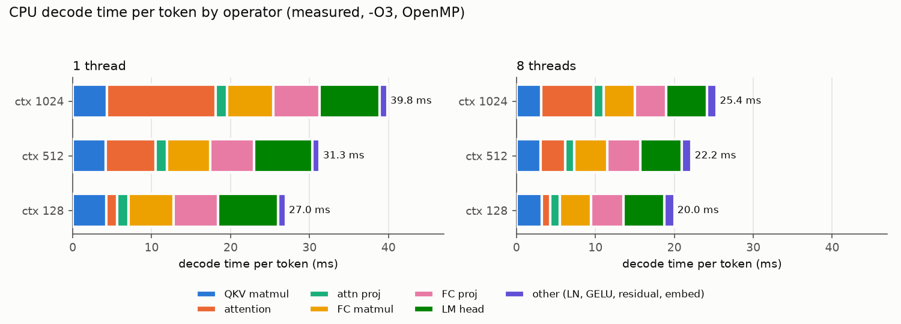
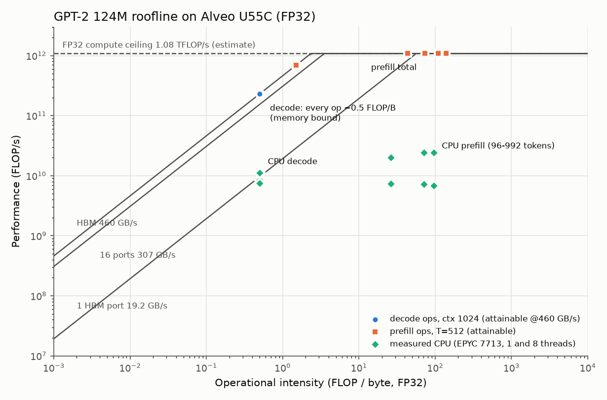

# GPT-2 124M on Alveo U55C: application analysis

Generated by `analysis/analyze.py` from model dimensions (C=768, L=12, NH=12, V=50257, maxT=1024).

## Assumptions

* FLOP counts: multiply and add = 2 FLOPs. LayerNorm 8 FLOPs/elem, GELU 12
  FLOPs/elem (tanh approx incl. tanh as ~4), softmax 5 FLOPs/score,
  residual 1 FLOP/elem. Nonlinear op costs are rough; they are <1% of FLOPs.
* Bytes: every weight read once per token (batch 1, no reuse across tokens),
  every activation read/written once from/to off-chip memory, KV cache read
  in full each decode step. All tensors (weights, activations, KV) in the
  stated precision; INT8 scale-factor overhead ignored.
* Prefill of T tokens reads weights once (ideal tiling) and touches T times
  the activations.

* U55C: one HBM AXI port = 512 bit x 300 MHz = 19.2 GB/s; full HBM = 460 GB/s; compute ceiling = 9024 DSP / 5 DSP per FP32 MAC x 2 FLOP x 300 MHz = 1.08 TFLOP/s (ESTIMATE: assumes every DSP is usable and Vitis HLS full-DSP fmul (3) + fadd (2)).
* On-chip memory: 2016 BRAM36 + 960 URAM = 44.7 MB (42.6 MiB).

## Decode: per-operator cost per token (context 1024; layer ops summed over 12 layers)

| op | shape | params (M) | MFLOP | FP32 MB moved | FP16 MB | INT8 MB | OI FP32 (FLOP/B) | OI INT8 |
|---|---|---|---|---|---|---|---|---|
| embed | (1,768) | 0.00 | 0.00 | 0.01 | 0.00 | 0.00 | 0.0833 | 0.333 |
| ln1 | 12 x (1,768) | 0.02 | 0.07 | 0.15 | 0.07 | 0.04 | 0.5 | 2 |
| qkv_matmul | 12 x (1,768)x(768,2304) | 21.26 | 42.47 | 85.19 | 42.60 | 21.30 | 0.498 | 1.99 |
| attention | 12 x 12h x 64 x ctx | 0.00 | 38.49 | 75.64 | 37.82 | 18.91 | 0.509 | 2.04 |
| attproj_matmul | 12 x (1,768)x(768,768) | 7.09 | 14.16 | 28.42 | 14.21 | 7.11 | 0.498 | 1.99 |
| residual1 | 12 x (1,768) | 0.00 | 0.01 | 0.11 | 0.06 | 0.03 | 0.0833 | 0.333 |
| ln2 | 12 x (1,768) | 0.02 | 0.07 | 0.15 | 0.07 | 0.04 | 0.5 | 2 |
| fc_matmul | 12 x (1,768)x(768,3072) | 28.35 | 56.62 | 113.58 | 56.79 | 28.39 | 0.499 | 1.99 |
| gelu | 12 x (1,3072) | 0.00 | 0.44 | 0.29 | 0.15 | 0.07 | 1.5 | 6 |
| fcproj_matmul | 12 x (1,3072)x(3072,768) | 28.32 | 56.62 | 113.47 | 56.73 | 28.37 | 0.499 | 2 |
| residual2 | 12 x (1,768) | 0.00 | 0.01 | 0.11 | 0.06 | 0.03 | 0.0833 | 0.333 |
| ln_f | (1,768) | 0.00 | 0.01 | 0.01 | 0.01 | 0.00 | 0.5 | 2 |
| lm_head | (1,768)x(768,50257) | 38.60 | 77.19 | 154.59 | 77.30 | 38.65 | 0.499 | 2 |
| argmax | (50257) | 0.00 | 0.05 | 0.20 | 0.10 | 0.05 | 0.25 | 1 |
| TOTAL |  | 123.65 | 286.22 | 571.93 | 285.97 | 142.98 | 0.5 | 2 |

Decode totals per token vs context:

| context | GFLOP | weights MB (FP32) | KV MB (FP32) | FP32 MB moved | OI FP32 | OI FP16 | OI INT8 |
|---|---|---|---|---|---|---|---|
| 128 | 0.253 | 495 | 9.51 | 505.87 | 0.499 | 0.998 | 2 |
| 512 | 0.267 | 495 | 37.8 | 534.18 | 0.5 | 1 | 2 |
| 1024 | 0.286 | 495 | 75.6 | 571.93 | 0.5 | 1 | 2 |

## Prefill of T tokens (weights read once; logits only for the last token)

| T | op | GFLOP | FP32 MB moved | OI FP32 |
|---|---|---|---|---|
| 128 | qkv_matmul | 5.44 | 103.92 | 52.3 |
| 128 | attention | 0.31 | 28.31 | 11 |
| 128 | fc_matmul | 7.25 | 136.99 | 52.9 |
| 128 | TOTAL | 22.21 | 684.95 | 32.4 |
| 512 | qkv_matmul | 21.74 | 160.54 | 135 |
| 512 | attention | 4.94 | 113.25 | 43.6 |
| 512 | fc_matmul | 28.99 | 207.77 | 140 |
| 512 | TOTAL | 92.30 | 1254.72 | 73.6 |
| 1024 | qkv_matmul | 43.49 | 236.04 | 184 |
| 1024 | attention | 19.72 | 226.49 | 87.1 |
| 1024 | fc_matmul | 57.98 | 302.14 | 192 |
| 1024 | TOTAL | 194.37 | 2014.41 | 96.5 |

## KV cache size (all 12 layers, K and V)

| context | FP32 MB | FP16 MB | INT8 MB |
|---|---|---|---|
| 1 | 0.074 | 0.037 | 0.018 |
| 128 | 9.437 | 4.719 | 2.359 |
| 256 | 18.874 | 9.437 | 4.719 |
| 512 | 37.749 | 18.874 | 9.437 |
| 1024 | 75.497 | 37.749 | 18.874 |

## Bandwidth-bound decode upper bound (tokens/s = bandwidth / bytes per token)

Upper bounds: assume 100% of the stated bandwidth and zero compute/launch overhead.

| context | precision | MB/token | 1 port 19.2 GB/s | 8 ports | 16 ports | HBM 460 GB/s |
|---|---|---|---|---|---|---|
| 128 | FP32 | 505.9 | 38.0 | 303.6 | 607.3 | 909.3 |
| 128 | FP16 | 252.9 | 75.9 | 607.3 | 1214.5 | 1818.6 |
| 128 | INT8 | 126.5 | 151.8 | 1214.5 | 2429.1 | 3637.3 |
| 512 | FP32 | 534.2 | 35.9 | 287.5 | 575.1 | 861.1 |
| 512 | FP16 | 267.1 | 71.9 | 575.1 | 1150.2 | 1722.3 |
| 512 | INT8 | 133.5 | 143.8 | 1150.2 | 2300.3 | 3444.5 |
| 1024 | FP32 | 571.9 | 33.6 | 268.6 | 537.1 | 804.3 |
| 1024 | FP16 | 286.0 | 67.1 | 537.1 | 1074.3 | 1608.6 |
| 1024 | INT8 | 143.0 | 134.3 | 1074.3 | 2148.5 | 3217.2 |

## On-chip fit (on-chip = 44.7 MB; ignores space needed by activations, KV tiles and FIFOs)

| tensor | params (M) | FP32 MB | fits FP32 | 2x buf FP32 | FP16 MB | fits FP16 | 2x buf FP16 | INT8 MB | fits INT8 | 2x buf INT8 |
|---|---|---|---|---|---|---|---|---|---|---|
| one block | 7.09 | 28.4 | yes | no | 14.2 | yes | yes | 7.1 | yes | yes |
| qkv_matmul | 1.77 | 7.1 | yes | yes | 3.5 | yes | yes | 1.8 | yes | yes |
| fc_matmul | 2.36 | 9.4 | yes | yes | 4.7 | yes | yes | 2.4 | yes | yes |
| fcproj_matmul | 2.36 | 9.4 | yes | yes | 4.7 | yes | yes | 2.4 | yes | yes |
| attproj_matmul | 0.59 | 2.4 | yes | yes | 1.2 | yes | yes | 0.6 | yes | yes |
| 12 blocks | 85.05 | 340.2 | no | no | 170.1 | no | no | 85.1 | no | no |
| lm_head (wte) | 38.60 | 154.4 | no | no | 77.2 | no | no | 38.6 | yes | no |
| whole model (incl. wpe) | 124.44 | 497.8 | no | no | 248.9 | no | no | 124.4 | no | no |

## Measured CPU baseline placed on the roofline

Achieved = analytic FLOPs (or bytes) per token x measured tokens/s.

| threads | context | decode tok/s | decode GFLOP/s | decode effective GB/s | prefill tok/s | prefill GFLOP/s |
|---|---|---|---|---|---|---|
| 1 | 128 | 36.84 | 9.30 | 18.64 | 42.42 | 7.34 |
| 1 | 512 | 32.04 | 8.55 | 17.11 | 39.79 | 7.15 |
| 1 | 1024 | 25.93 | 7.42 | 14.83 | 36.23 | 6.85 |
| 8 | 128 | 52.67 | 13.30 | 26.65 | 115.75 | 20.04 |
| 8 | 512 | 44.82 | 11.97 | 23.94 | 135.18 | 24.29 |
| 8 | 1024 | 39.10 | 11.19 | 22.36 | 127.64 | 24.15 |

## Measured CPU decode time per operator (ms/token)

| threads | context | QKV matmul | attention | attn proj | FC matmul | FC proj | LM head | other (LN, GELU, residual, embed) | total |
|---|---|---|---|---|---|---|---|---|---|
| 1 | 128 | 4.27 | 1.35 | 1.43 | 5.69 | 5.69 | 7.60 | 0.95 | 26.98 |
| 1 | 512 | 4.19 | 6.31 | 1.42 | 5.52 | 5.57 | 7.35 | 0.95 | 31.30 |
| 1 | 1024 | 4.32 | 13.76 | 1.49 | 5.83 | 5.86 | 7.62 | 0.95 | 39.83 |
| 8 | 128 | 3.24 | 1.02 | 1.22 | 3.99 | 4.12 | 5.12 | 1.28 | 19.99 |
| 8 | 512 | 3.09 | 3.11 | 1.14 | 4.14 | 4.20 | 5.24 | 1.27 | 22.18 |
| 8 | 1024 | 3.12 | 6.64 | 1.26 | 4.02 | 3.95 | 5.12 | 1.25 | 25.36 |

